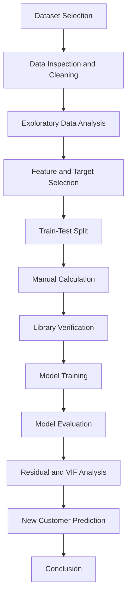

# Activity1-Ecommerce-Spending-MLR-AD3316
Ecommerce Customer Spending Prediction using Multiple Linear Regression, including manual calculations, exploratory data analysis, model comparison, performance evaluation and residual analysis. Developed for RCA CIE-2 Activity 1 | AD3316.


# 🛒 Ecommerce Customer Spending Prediction

### Multiple Linear Regression | RCA CIE-2 Activity 1


---

## 📌 Project Overview

This project is developed as part of **CIE-2 Activity 1 – Multiple Linear Regression Worksheet** for the subject Regression and Classification Algorithms (RCA).

The objective is to predict the yearly amount spent by e-commerce customers based on their online shopping behaviour and membership duration.

The project compares a Mean Baseline, Single Linear Regression and Multiple Linear Regression to understand how multiple input features improve prediction performance.

## 🎯 Objectives

- Understand the relationship between customer behaviour and yearly spending.
- Perform exploratory data analysis and correlation analysis.
- Calculate regression coefficients manually using the normal equation.
- Verify manual calculations using Scikit-learn.
- Compare Single and Multiple Linear Regression models.
- Interpret regression coefficients and feature influence.
- Evaluate model performance using regression metrics.
- Analyse residuals and multicollinearity.
- Predict yearly spending for a new customer.

## 📖 Problem Statement

An e-commerce company wants to understand the factors associated with customer spending and determine whether its mobile application, website engagement or customer membership duration is more strongly associated with yearly spending.

As a data analyst, the task is to develop a Multiple Linear Regression model that predicts yearly customer spending and provides useful insights to support business decisions.

## 📊 Dataset Description

**Dataset:** Ecommerce Customers

**Source:** [Kaggle - Ecommerce Customers](https://www.kaggle.com/datasets/kolawale/focusing-on-mobile-app-or-website)

| Parameter | Details |
|---|---|
| File Format | CSV |
| Total Records | 500 |
| Original Columns | 8 |
| Input Features | 4 |
| Target Variable | 1 |
| Missing Values | 0 |
| Duplicate Records | 0 |

### Input Features (X)

| Feature | Description |
|---|---|
| Avg. Session Length | Average duration of customer sessions |
| Time on App | Time spent on the mobile application |
| Time on Website | Time spent on the website |
| Length of Membership | Duration of customer membership |

### Target Variable (y)

**Yearly Amount Spent** – The total yearly spending of a customer.

Email, Address and Avatar are excluded from model training because they are not relevant numerical predictors.

## 🛠️ Tools and Technologies

| Technology | Purpose |
|---|---|
| Python | Programming language |
| Jupyter Notebook | Development environment |
| Pandas | Data loading and manipulation |
| NumPy | Numerical and matrix calculations |
| Matplotlib | Data visualization |
| Seaborn | Statistical visualization |
| Scikit-learn | Model training and evaluation |
| Statsmodels | Multicollinearity analysis using VIF |

## 🔄 Project Workflow



## 📝 Implementation Steps

### Step 1: Dataset Selection

Select a suitable regression dataset and identify the input features and continuous target variable.

### Step 2: Data Inspection and Cleaning

- Display sample records.
- Check dataset dimensions and data types.
- Calculate descriptive statistics.
- Check missing values and duplicate records.

### Step 3: Exploratory Data Analysis

- Generate a correlation heatmap.
- Visualize relationships between input features and yearly spending.
- Identify strongly and weakly correlated features.

### Step 4: Manual Calculation

Select five training observations with two input features:

- Time on App
- Length of Membership

The regression coefficients are calculated using the normal equation:

$$
\beta = (X^TX)^{-1}X^Ty
$$

The manually calculated coefficients are:

| Parameter | Value |
|---|---:|
| Intercept | -129.338324 |
| Time on App | 38.696210 |
| Length of Membership | 48.322010 |

The fitted equation for the selected sample is:

$$
\hat{y}=-129.338324+38.696210x_1+48.322010x_2
$$

The coefficients are verified using Scikit-learn's LinearRegression model.

**Verification Result: Agreement = True**

### Step 5: Model Training

The dataset is divided into training and testing sets.

| Dataset | Percentage | Records |
|---|---:|---:|
| Training Set | 80% | 400 |
| Testing Set | 20% | 100 |

**Random State:** 42

The following models are compared:

- Mean Baseline Model
- Single Linear Regression
- Multiple Linear Regression

Length of Membership is selected for Single Linear Regression, while all four numerical features are used for Multiple Linear Regression.

### Step 6: Regression Equation and Interpretation

The general Multiple Linear Regression equation is:

$$
\hat{y}=b_0+b_1x_1+b_2x_2+b_3x_3+b_4x_4
$$

The fitted model equation is approximately:

$$
\hat{y}=-1044.2574+25.5963x_1+38.7853x_2+0.3104x_3+61.8968x_4
$$

Where:

| Variable | Feature |
|---|---|
| x₁ | Avg. Session Length |
| x₂ | Time on App |
| x₃ | Time on Website |
| x₄ | Length of Membership |

Each coefficient represents the estimated change in yearly spending for a one-unit increase in the corresponding feature, holding the remaining features constant.

Standardized coefficients are used to compare the relative influence of features.

### Step 7: Model Predictions

The trained model predicts yearly customer spending for unseen testing records.

Actual and predicted values are compared to understand prediction performance.

### Step 8: Model Evaluation

The models are evaluated using:

| Metric | Description |
|---|---|
| MAE | Mean Absolute Error |
| MSE | Mean Squared Error |
| RMSE | Root Mean Squared Error |
| R² | Coefficient of Determination |
| Adjusted R² | R² adjusted for the number of input features |

### Step 9: Residual Analysis and Assumptions

The following analyses are performed:

- Actual vs Predicted plot
- Residual Distribution
- Residual vs Predicted plot
- Variance Inflation Factor (VIF)

The assumptions of linear regression are examined:

- Linearity
- Independence of errors
- Constant error variance
- Approximate normality of errors
- No severe multicollinearity

### Step 10: New Customer Prediction

A new customer record is provided to the trained model to estimate yearly spending.

## 📈 Model Performance

| Model | R² Score |
|---|---:|
| Mean Baseline | -0.0362 |
| Single Linear Regression | 0.5634 |
| Multiple Linear Regression | **0.9778** |

### Multiple Linear Regression Results

| Evaluation Metric | Value |
|---|---:|
| MAE | 8.5584 |
| RMSE | 10.4816 |
| R² | 0.9778 |
| Adjusted R² | 0.9769 |

Multiple Linear Regression achieves better test performance than the Single Linear Regression and Mean Baseline models.

The model explains approximately **97.78% of the variation in yearly customer spending** in the test dataset.

## 📉 Visualizations

The following visualizations are included in the Jupyter Notebook:

- Correlation Heatmap
- Pair Plot
- Actual vs Predicted Values
- Residual Distribution
- Residual Scatter Plot

These visualizations help understand feature relationships, model performance and regression assumptions.

## 🔍 Key Findings

- Length of Membership has the strongest predictive association with yearly spending.
- Time on App is another important predictor of customer spending.
- Average Session Length has a positive association with spending.
- Time on Website has very little predictive influence.
- VIF analysis indicates no severe multicollinearity.
- Multiple Linear Regression performs better than Single Linear Regression.

## 💰 New Customer Spending Prediction

| Input Feature | Value |
|---|---:|
| Avg. Session Length | 34.5 |
| Time on App | 12.5 |
| Time on Website | 37.0 |
| Length of Membership | 4.0 |

**Predicted Yearly Amount Spent: 582.70 monetary units**

## 📂 Repository Structure

```text
RCA-CIE2-Activity-1-RollNo-AD3316/
│
├── Ecommerce_Customer_Spending_Prediction_Activity_1.ipynb
├── Ecommerce Customers.csv
└── README.md
```

## 🚀 How to Run the Project

### 1. Clone the Repository

```bash
git clone https://github.com/HardikRavriya/RCA-CIE2-Activity-1-RollNo-AD3316.git
```

### 2. Install Required Libraries

```bash
pip install pandas numpy matplotlib seaborn scikit-learn statsmodels jupyter
```

### 3. Launch Jupyter Notebook

```bash
jupyter notebook
```

### 4. Execute the Notebook

- Open the project notebook.
- Ensure the dataset is available in the same directory.
- Run all cells sequentially to obtain the results.

## ⚠️ Limitations

- Correlation does not prove causation.
- Linear Regression may not capture nonlinear relationships.
- Other factors affecting customer spending are not included in the dataset.
- Predictions outside the observed feature ranges may be unreliable.
- Model predictions should be treated as estimates rather than guaranteed outcomes.

## Decision Log

| Decision | Reason |
|---|---|
| Selected Ecommerce Customers dataset | Suitable for predicting a continuous target variable. |
| Excluded Email, Address and Avatar | Not relevant numerical predictors. |
| Used an 80:20 train-test split | To evaluate performance on unseen data. |
| Selected Length of Membership for single regression | Strong association with yearly spending. |
| Selected Multiple Linear Regression | Achieved better prediction performance. |
| Used residual analysis and VIF | To examine regression assumptions and multicollinearity. |

## ✅ Conclusion

This project demonstrates the implementation and evaluation of Multiple Linear Regression using the Ecommerce Customers dataset.

The Multiple Linear Regression model achieved a test R² score of 0.9778 and an adjusted R² score of 0.9769, performing better than Single Linear Regression.

Length of Membership and Time on App are important predictors of yearly customer spending.

The model can support e-commerce businesses in understanding customer behaviour and making informed marketing decisions, while considering its assumptions and limitations.

## 🎓 Academic Information

| Particular | Details |
|---|---|
| Student Name | Hardik Ravriya |
| Roll Number | AD3316 |
| College | Zeal College of Engineering and Research, Pune |
| Department | Artificial Intelligence and Data Science |
| Class | T.Y. B.Tech |
| Semester | V |
| Academic Year | 2026–27 |
| Subject | Regression and Classification Algorithms |
| Assessment | CIE-2 Activity 1 |
| Topic | Multiple Linear Regression Worksheet |

## 📚 References

- [Ecommerce Customers Dataset - Kaggle](https://www.kaggle.com/datasets/kolawale/focusing-on-mobile-app-or-website)

## 👨‍🏫 Faculty GitHub Profile

[https://github.com/complexiota](https://github.com/complexiota)

---

**Developed as part of RCA CIE-2 Activity 1 | Academic Year 2026–27**
